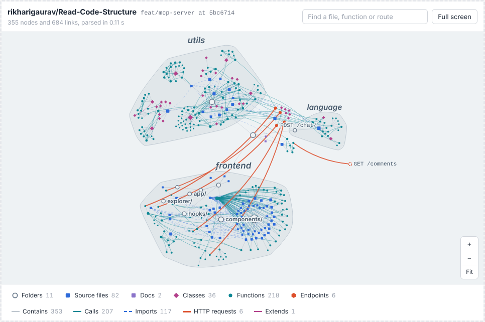
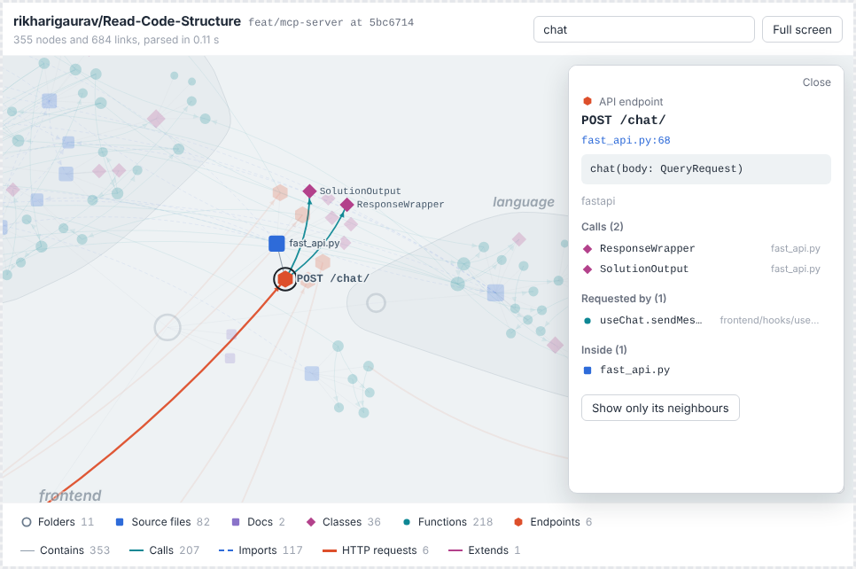
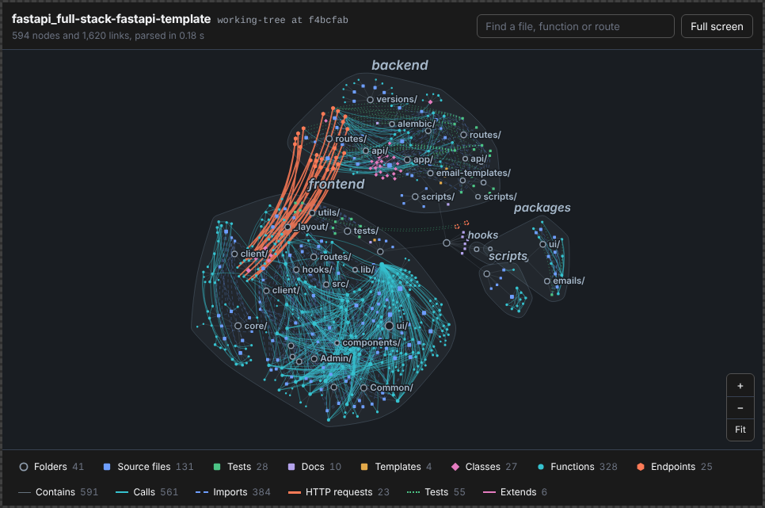
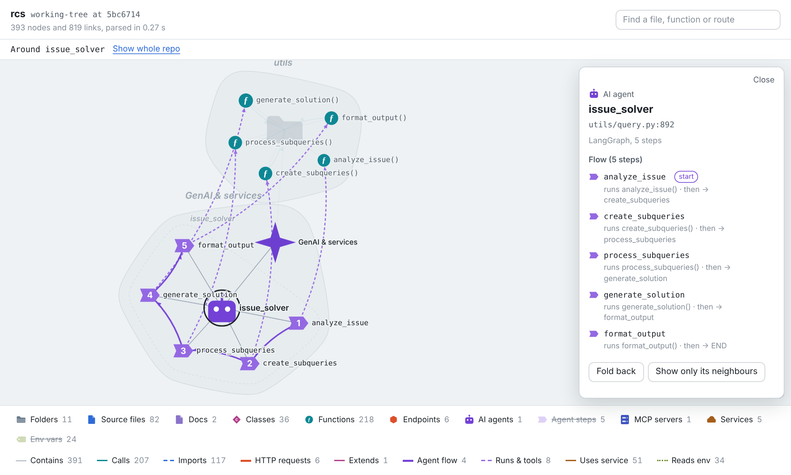

# repo-graph-mcp

Share a repository with Claude and get its **code-structure graph** back: folders, files, classes,
functions and API endpoints, with the calls, imports, tests and HTTP requests between them, as an
interactive map you can pan, search, filter and click through. A **GenAI & services** layer sits beside
the code: the AI agents in it (and their steps and tools), MCP servers, the LLMs, vector/graph databases
and other services it calls, and the env vars it reads, each linked to the functions behind it.

It's the graph half of [Read-Code-Structure](https://github.com/rikharigaurav/Read-Code-Structure),
packaged as a Claude plugin. It makes no LLM summaries and no embeddings, so a typical repo is graphed in
a second or two instead of minutes, and it needs no API keys.

It runs two ways:
- **Agent mode** (the default; works as soon as the plugin is installed). Claude runs the bundled graph
  builder with its own tools, then shows the graph as an artifact in the Claude app, or opens it in your
  browser from Claude Code. All you need is Python 3.10+ and git.
- **MCP mode** (optional). A small server renders the graph inside the chat itself, as an MCP App. You
  can run it locally or host it once for claude.ai on web and mobile.



<table><tr>
<td></td>
<td></td>
</tr></table>

## What it does

| | Read-Code-Structure backend | repo-graph-mcp |
|---|---|---|
| File categorising | Mistral call per folder | Deterministic rules (same categories) |
| Structure | tree-sitter (Python) | tree-sitter (Python, JavaScript, TypeScript, JSX/TSX) |
| Summaries | LLM per function/file | First line of the docstring/JSDoc |
| Vectors | Pinecone embeddings | none |
| Storage | Neo4j (required) | in-memory + disk cache per commit; Neo4j optional |
| Output | your web UI | interactive view inside Claude, plus a summary for the model |

The graph uses the same labels and relationships as the backend's Neo4j schema, so it can be pushed into
the same database. It adds a few that are free to compute:

| Nodes | |
|---|---|
| `Folder` | every folder that contains a kept file |
| `DataFile` · `TestingFile` · `DocumentationFile` · `TemplateMarkupFile` | files, classified by rules (configs, lock files, binaries, generated and vendored code are skipped) |
| `Class` | classes, with their bases |
| `Function` | functions and methods (`qualname`, signature, lines, docstring) |
| `ApiEndpoint` | FastAPI / Flask / Starlette decorators (incl. `APIRouter(prefix=…)`), Express-style `app.get('/x', …)`, Next.js `app/**/route.ts` and `pages/api`. External or unresolved routes your code calls are added too, marked "not defined in this repo" |

| Relationships | |
|---|---|
| `BELONGS_TO` | containment: function → class → file → folder |
| `IMPORTS` | file → file, incl. relative imports, `src/` layouts and tsconfig `paths` aliases like `@/` |
| `CALLS` | resolved statically: local names, imports, `self`/`this` methods incl. inherited ones, module instances (`from db import app; app.query()`), `Cls(...).method()`, React components used in JSX |
| `EXTENDS` | class → base class |
| `TEST` | test file → functions and endpoints it exercises (`client.get('/users/42')` matches `/users/{id}`) |
| `GET` · `POST` · … | client code (`fetch`, axios, requests/httpx, generated API clients) → the endpoint it hits, including through proxy prefixes like `/api` or `/api/v1` |

### GenAI & services layer



Found by the same static pass (Python via `ast`, JS/TS via the parse plus targeted patterns) and grouped
under one `GenAI` hub node, so the view shows it as its own territory. Every link records the `file`
and `line` it came from and a `basis`: `declared` when the code says it outright, `inferred` when it
follows a value (a call on an object built from an SDK client).

| Nodes | |
|---|---|
| `Agent` | LangGraph `StateGraph` / `MessageGraph` (Python and LangGraph.js), prebuilt agents (`create_react_agent`, `create_supervisor`, `create_deep_agent`, `AgentExecutor`…) and framework agents (`Agent(...)` from the OpenAI Agents SDK, PydanticAI, CrewAI, smolagents, AutoGen, Google ADK, LlamaIndex…) |
| `AgentStep` | one node of an agent's graph, numbered in the order it was added, with its entry and END flags |
| `McpServer` | `FastMCP(...)` / low-level `Server(...)` (and `McpServer` in TypeScript) with the tools, resources and prompts registered on it |
| `ExternalService` | LLM providers, vector DBs, graph DBs, databases, caches, queues, cloud SDKs, payments, auth/backends and well-known APIs: from SDK imports, client objects, `"provider:model"` strings and URLs like `https://api.github.com/…` |
| `EnvVar` | `os.getenv`, `os.environ[...]`, pydantic `BaseSettings` fields (with `env_prefix` and aliases), `process.env`, `import.meta.env`; marked required / has a default / optional, and flagged when a secret-looking name has a browser prefix such as `NEXT_PUBLIC_` |

| Relationships | |
|---|---|
| `NEXT` | step → step (`kind`: `edge`, `conditional` via a router, or `goto` from `Command(goto=…)`) |
| `RUNS` · `ROUTES` | step → the function (or sub-agent) it runs · step → the router function that decides where it goes next |
| `USES_TOOL` | agent, `ToolNode` step or a function calling `bind_tools` → tool functions (`@tool`, `@function_tool`, tool lists, even when the list lives in another module) |
| `EXPOSES` | MCP server → the functions behind `@mcp.tool()`, `@mcp.resource(...)`, `@mcp.prompt()` |
| `USES` | function → service it calls, including through a client imported from another module |
| `READS_ENV` | function / settings class → env var |

Code under `docs/`, `examples/`, test folders and migrations isn't scanned for this layer, and nothing
outside the repository (cloud consoles, deployed config) can be seen. Infrastructure files (compose,
Kubernetes, Terraform) are left to tools built for them.

## MCP tools (MCP mode)

| Tool | Shown to | What it does |
|---|---|---|
| `graph_repo` | model + view | Fetch and parse a repo, render the interactive graph, return a summary and a `graph_id` |
| `explore_graph` | model + view | Focused view around one node: callers, callees, imports, tests (`direction`, `depth`, `relations`) |
| `search_graph` | model | Find nodes by name/path/docstring |
| `graph_view_data` | view only | Lets the view load the whole graph from an explore result |
| `push_graph_to_neo4j` | model | Only when `NEO4J_URI` is set: write the graph into Neo4j (ids namespaced per repo) |

The graph itself goes to the view as `structuredContent`, which MCP Apps hosts keep out of the model's
context. Claude gets a compact summary instead (layout, endpoints and who calls them, agents and their
flow, MCP servers, services, env vars and any leaked browser secrets, most-called functions, most-imported
files, test reach) and uses `explore_graph`/`search_graph` to dig further.

In the view you can:
- click a node for its details and relationships; every entry is clickable;
- double-click a file to show its functions, or a folder to fold or unfold it;
- double-click an agent to break it down into its numbered steps, the functions they run, routers and tools;
  a service to show the code that uses it; an MCP server for what it exposes; an env var for where it's read;
- search with `/`, zoom with ctrl/⌘ + scroll (plain scroll once you've clicked into the map), and fit with `0`;
- toggle node and link kinds in the legend;
- in MCP mode, use "Ask Claude about this" to send the selection back to the chat.

Large repos open as an overview: functions and docs hidden, deep folders folded. The status line says what
was folded and how to open it.

## Install the plugin (agent mode)

In Claude Code:

```
/plugin marketplace add rikharigaurav/repo-graph-mcp
/plugin install repo-graph@repo-graph-mcp
```

In the Claude app, add the marketplace `rikharigaurav/repo-graph-mcp` and install `repo-graph`.

That's all. The plugin contains only a skill (`graph-repo`), an agent (`repo-grapher`) and the bundled
builder, so there's no server to start. You need Python 3.10+ and git wherever Claude runs code. On first
use the builder installs tree-sitter into a private environment in your cache folder
(`%LOCALAPPDATA%\repo-graph` on Windows, `~/.cache/repo-graph` elsewhere), never into your global Python.

### Use it

Start a new chat or session after installing, then ask:

- "Graph https://github.com/rikharigaurav/Read-Code-Structure", or `/graph-repo <repo>`
- "Graph the `feat/mcp-server` branch, just the `frontend` folder"
- "What calls `create_relation`, two levels up?"
- "Which frontend code hits `POST /chat/`?" and "Which endpoints have no tests?"

In the Claude app the graph appears as an artifact. In Claude Code it opens in your browser, and the
files stay in the cache folder. Follow-up questions are answered from the saved graph, so they're
instant. Private repos work whenever your own `git clone` works.

You can also run the builder yourself:

```bash
python skills/graph-repo/scripts/graph_repo.py build https://github.com/owner/repo --out ./graph
python skills/graph-repo/scripts/graph_repo.py explore ./graph "POST /chat/" --direction in --depth 2
python skills/graph-repo/scripts/graph_repo.py search  ./graph neodb
```

## Optional: MCP mode (graph inside the chat)

MCP mode needs [uv](https://docs.astral.sh/uv/), or Python ≥ 3.10 and pip. The plugin doesn't start the
server by default. That's deliberate: a plugin that launches a program fails silently when the runtime
is missing. Enable it in one of these ways. When the tools are present, the skill uses them automatically.

Set `GITHUB_TOKEN` for private repos and higher GitHub rate limits. Without it, the server uses anonymous
access and falls back to `git clone` when rate-limited.

### Claude Code

```
claude mcp add repo-graph -- uvx --from git+https://github.com/rikharigaurav/repo-graph-mcp repo-graph-mcp
```

The same configuration is in [`mcp/repo-graph.mcp.json`](mcp/repo-graph.mcp.json) if you'd rather copy it
into a project's `.mcp.json`.

### Claude Desktop (local server)

Add to `claude_desktop_config.json`. On Windows, use the full path to `uvx.exe` (find it with
`where.exe uvx`) because the app may not see your updated PATH:

```json
{
  "mcpServers": {
    "repo-graph": {
      "command": "uvx",
      "args": ["--from", "git+https://github.com/rikharigaurav/repo-graph-mcp", "repo-graph-mcp"],
      "env": { "GITHUB_TOKEN": "ghp_…" }
    }
  }
}
```

A local server can also graph folders on your machine: pass an absolute path as the repo.

### claude.ai (web and mobile): host it as a custom connector

Run the HTTP server somewhere public, for example on your own site:

```bash
docker build -t repo-graph-mcp .
docker run -d -p 8000:8000 -v repo-graph-cache:/data \
  -e GITHUB_TOKEN=ghp_… \
  -e REPO_GRAPH_AUTH_TOKEN="$(openssl rand -hex 24)" \
  -e REPO_GRAPH_ALLOWED_HOSTS=graph.your-site.com \
  repo-graph-mcp
```

Put it behind HTTPS, then in Claude go to **Settings → Connectors → Add custom connector** and use
`https://graph.your-site.com/mcp?key=<REPO_GRAPH_AUTH_TOKEN>`. Without Docker:
`pip install . && repo-graph-mcp --http --host 0.0.0.0 --port 8000`.

Hosted mode never reads paths on the server's own disk unless you set `REPO_GRAPH_ALLOW_LOCAL_PATHS=1`.

## Configuration

| Variable | Default | |
|---|---|---|
| `GITHUB_TOKEN` | – | Private repos, higher rate limits (`GH_TOKEN` also works) |
| `REPO_GRAPH_CACHE_DIR` | system temp | Where downloads are unpacked and graphs are cached (gzipped JSON per commit) |
| `REPO_GRAPH_MAX_FILES` | `6000` | Files graphed per repo (shallowest first) |
| `REPO_GRAPH_MAX_FILE_KB` | `768` | Larger files are skipped |
| `REPO_GRAPH_MAX_DOWNLOAD_MB` | `300` | Archive size limit |
| `REPO_GRAPH_UI_MAX_NODES` | `6000` | Nodes sent to the view (most structural first) |
| `REPO_GRAPH_MAX_CONCURRENT_BUILDS` | `2` | Parallel builds in hosted mode |
| `REPO_GRAPH_AUTH_TOKEN` | – | HTTP mode: require `Authorization: Bearer …` or `?key=…` |
| `REPO_GRAPH_ALLOWED_HOSTS` | – | HTTP mode: enable DNS-rebinding protection for these hostnames |
| `REPO_GRAPH_ALLOW_LOCAL_PATHS` | `1` stdio, `0` HTTP | Allow graphing directories on the server |
| `NEO4J_URI`, `NEO4J_USERNAME`, `NEO4J_PASSWORD`, `NEO4J_DATABASE` | – | Enables `push_graph_to_neo4j` (`pip install "repo-graph-mcp[neo4j]"`) |

## Using it with the existing Neo4j explorer

With `NEO4J_*` set, ask Claude to "save this graph to Neo4j". Nodes keep the backend's labels and property
names (`file_name`, `function_name`, `endpoint_name`, `http_method`, …) plus `repo`, so existing Cypher
keeps working. Scope it to one repo with `MATCH (n {repo: 'owner/name'})`. Re-pushing replaces only that
repo's nodes.

## How it works

1. **Fetch**: agent mode runs `git clone --depth 1` with your own credentials. MCP mode first resolves
   the commit SHA (one small GitHub API call) and stops there on a cache hit; otherwise it downloads the
   tarball and extracts it, skipping `node_modules`, build output, VCS folders and oversized files.
   `/tree/<branch>/<folder>` links are matched against the real branch names, so branches containing
   slashes work.
2. **Classify**: the rules from the backend's LLM prompt, applied deterministically.
3. **Parse**: tree-sitter for Python, JS, TS, JSX and TSX; one pass per file collects symbols, imports,
   call sites, routes and HTTP client calls.
4. **Resolve**: module index (Python packages, relative imports, tsconfig paths), then calls, inheritance,
   tests and HTTP links. An edge is only added when its target is actually defined in the repo; there is
   no fuzzy name matching.
5. **GenAI layer** (`genai.py`): agents, tools, MCP servers, services and env vars, linked to the nodes
   resolved above, in two passes so clients built in one module are followed where they're imported.
6. **Deliver**: summary to the model, graph to the view, cached by commit.

Limits: only Python and JS/TS are parsed into symbols (other languages show as files). Dynamic dispatch,
dependency injection and reflection aren't followed. Route matching is static, so routes built at
runtime won't appear.

## Development

```bash
python -m venv .venv && . .venv/bin/activate
pip install -e ".[dev]"
pytest -q

# after changing the parser or the view, refresh the copy bundled with the skill (a test checks this)
python tools/sync_skill_bundle.py

# the in-chat view (TypeScript, bundled into one HTML file inside the Python package)
cd ui-src && npm ci && npm run build      # writes src/repo_graph_mcp/ui/graph-view.html
```

The view talks to the host using the MCP Apps protocol (`ui/initialize`, `ui/notifications/tool-result`,
`tools/call`, `ui/open-link`, `ui/message`, `ui/update-model-context`) through a small built-in bridge.
That keeps the bundle around 65 KB, where the official SDK would add about 650 KB. To try it outside Claude,
run `repo-graph-mcp --http --port 3001` and open it in the
[MCP Apps basic-host](https://github.com/modelcontextprotocol/ext-apps/tree/main/examples/basic-host).

## License

MIT
